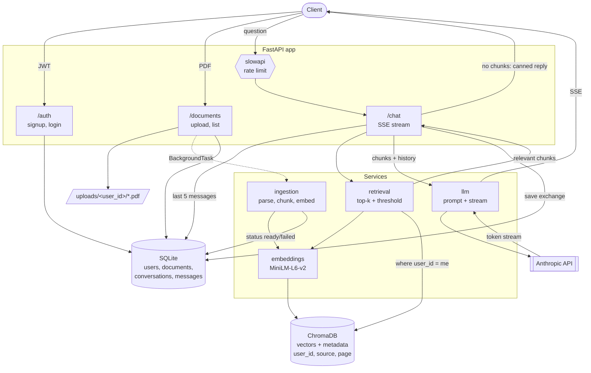

# Chat with Your Documents (RAG)

A FastAPI service where users sign up, upload PDFs, and chat with them. Answers are
**grounded in the user's own documents**, **streamed** over Server-Sent Events, and
carry **file + page citations**. If nothing relevant is found, the service says so
*without calling the LLM*.

> **Deep dive:** see [`docs/PROJECT_GUIDE.md`](docs/PROJECT_GUIDE.md) for the full explanation
> (tech choices, internals with diagrams, limitations) plus an interview Q&A bank.

| Concern        | Choice                                                    |
| -------------- | --------------------------------------------------------- |
| API            | FastAPI (Python 3.11+)                                    |
| Vector store   | ChromaDB (persistent, cosine distance)                    |
| Embeddings     | `sentence-transformers/all-MiniLM-L6-v2` (local, CPU OK)  |
| Generation     | Anthropic SDK (default) or Google Gemini, via `LLM_PROVIDER` |
| PDF parsing    | `pypdf` (per page)                                        |
| Relational DB  | SQLite + SQLAlchemy 2.0 (users, documents, chat history)  |
| Auth           | JWT (`python-jose`) + `passlib` password hashing          |
| Rate limiting  | `slowapi` on `/chat` (per user, falls back to IP)         |

## Setup

```powershell
# 1. Virtual environment (Python 3.11+)
python -m venv venv
.\venv\Scripts\Activate.ps1          # macOS/Linux: source venv/bin/activate

# 2. Dependencies (first run downloads torch + the embedding model, ~1 GB)
pip install -r requirements.txt

# 3. Configuration
copy .env.example .env               # macOS/Linux: cp .env.example .env
#   - set JWT_SECRET:  python -c "import secrets; print(secrets.token_urlsafe(48))"
#   - pick an LLM: set ANTHROPIC_API_KEY, or LLM_PROVIDER=gemini + GEMINI_API_KEY

# 4. Run
uvicorn app.main:app --reload
```

- **Web UI:** <http://127.0.0.1:8000/> (sign up, upload PDFs, chat)
- **Interactive API docs:** <http://127.0.0.1:8000/docs> (use **Authorize** after logging in)

> Tip: `uvicorn app.main:app --reload --reload-dir app` restarts only when app code changes
> (each restart reloads the embedding model, which takes a few seconds).

## Web UI

A dependency-free single page app (`app/static/`: HTML + CSS + vanilla JS) is served by FastAPI
at `/`, so there is no build step and no CORS to configure.

- **Log in / Sign up:** tabs on one card; server validation errors are shown inline; the JWT is
  kept in `localStorage`, and an expired token returns you to the login screen.
- **Documents sidebar:** click or drag & drop PDFs. Each document shows `processing` (with a
  spinner), `ready` (pages/chunks) or `failed` (with the reason). The list refreshes itself
  while anything is still being ingested.
- **Chat:** answers stream token by token (the UI reads the SSE stream with `fetch`, since
  `EventSource` cannot POST or send an `Authorization` header). `[n]` markers become citation
  chips whose tooltip shows the file and page (hover a chip). There is no separate sources list,
  and excerpt text is neither displayed nor stored in chat history. Follow-up questions continue the same conversation; **New chat**
  starts a fresh one. Enter sends, Shift+Enter inserts a newline.
- All user-controlled text (filenames, answers) is rendered with `textContent`, never `innerHTML`.

> Want to pin Python 3.11 exactly? With [uv](https://docs.astral.sh/uv/):
> `uv venv --python 3.11 venv && uv pip install -r requirements.txt`

### Try it with curl

```bash
# Sign up, then log in (login is an OAuth2 *form*; username = email)
curl -X POST localhost:8000/auth/signup -H "Content-Type: application/json" \
     -d '{"email":"me@example.com","password":"a-strong-password"}'
TOKEN=$(curl -s -X POST localhost:8000/auth/login \
     -d "username=me@example.com&password=a-strong-password" | python -c "import sys,json;print(json.load(sys.stdin)['access_token'])")

# Upload a PDF (returns 202 immediately; ingestion runs in the background)
curl -X POST localhost:8000/documents/upload -H "Authorization: Bearer $TOKEN" -F "file=@report.pdf"
curl localhost:8000/documents -H "Authorization: Bearer $TOKEN"     # wait for status "ready"

# Chat (-N disables curl buffering so you see the stream)
curl -N -X POST localhost:8000/chat -H "Authorization: Bearer $TOKEN" \
     -H "Content-Type: application/json" -d '{"question":"What does the report conclude?"}'
```

## API

| Method & path           | Auth | Description                                                         |
| ----------------------- | ---- | ------------------------------------------------------------------- |
| `POST /auth/signup`     | no   | Create an account (`201`; `409` if the email exists)                |
| `POST /auth/login`      | no   | OAuth2 password form -> `{access_token, token_type}`                |
| `POST /documents/upload`| yes  | Upload a PDF; `202` with `status: processing`                       |
| `GET /documents`        | yes  | List the caller's documents (`processing` / `ready` / `failed`)     |
| `POST /chat`            | yes  | Ask a question; SSE stream. Rate limited (default `10/minute`)      |
| `GET /health`           | no   | Liveness probe                                                      |

### `/chat` stream format

Request: `{"question": "...", "conversation_id": 12}` (`conversation_id` optional; omit to start a new thread).

Every event's `data` is JSON:

```
event: sources
data: [{"index":1,"source":"report.pdf","page":4,"distance":0.31,"snippet":"..."}]

event: token
data: {"text":"The report concludes "}

event: token
data: {"text":"that revenue grew [1]."}

event: done
data: {"conversation_id": 12}
```

`[n]` markers in the answer refer to `sources[].index`. An `error` event
(`{"detail": "..."}`) ends the stream if generation fails. When no chunk passes the
relevance threshold, `sources` is `[]` and a fixed "not in your documents" message is
streamed; the LLM is never invoked.

## Architecture



### Request lifecycles

**Ingestion** (`POST /documents/upload`)
1. Validate extension, `%PDF-` magic bytes and size cap while streaming to `uploads/<user_id>/<uuid>.pdf`.
2. Insert a `Document` row (`processing`) and return `202`.
3. A `BackgroundTask` (own DB session) extracts text **per page**, chunks each page
   (800 chars, 150 overlap, snapped to word boundaries), embeds the chunks, and stores
   them in Chroma with metadata `{user_id, source, page, document_id, chunk_index}`.
4. The row becomes `ready` (with page/chunk counts) or `failed` (with an error message
   and any partial vectors removed). Scanned/image-only PDFs fail with a clear message.

**Chat** (`POST /chat`)
1. Rate limit check (keyed by user id from the JWT).
2. Load the last 5 messages of the conversation (404 if it belongs to someone else).
3. Embed the question and query Chroma with `where={"user_id": <caller>}`; drop chunks whose
   cosine distance exceeds `DISTANCE_THRESHOLD`.
4. **No chunks left?** Stream the "not in your documents" reply; skip the LLM.
5. Otherwise build the prompt (numbered excerpts + history), stream tokens from Claude.
6. Persist the user question and assistant answer (with sources) in one transaction.

### Design notes

- **Per-user isolation** is enforced in the vector query itself (`where` filter), the user
  id always comes from the verified JWT (never the request body), and results are re-checked
  after retrieval. Conversations are also owner-checked.
- **Prompt-injection hygiene:** retrieved text is wrapped in `<context>` tags and the system
  prompt declares it untrusted data, to be cited, not obeyed.
- **Consistent history:** exchanges are saved only after a complete answer, so a failed stream
  never leaves an unanswered question that would corrupt later turns.
- **Cosine distance** (`hnsw:space=cosine`) makes `DISTANCE_THRESHOLD` meaningful: 0 is
  identical, higher is less related. With MiniLM, specific questions score ~0.3-0.55, short
  or generic ones (e.g. "What is the job title?") land around 0.7-0.8, and small talk such as
  "hi" scores ~0.8+. The default cutoff of 0.8 is therefore a loose pre-filter; the prompt makes
  the LLM refuse when the excerpts don't actually answer. Each request logs the nearest
  distance (`retrieval ... nearest=...`) so you can tune `DISTANCE_THRESHOLD` with the eval script.
- **Password hashing** uses PBKDF2-SHA256 via passlib, because passlib 1.7.4's bcrypt backend
  breaks with `bcrypt>=5`.

## Project layout

```
app/
  main.py              app factory, lifespan, router + rate-limit wiring
  config.py            pydantic-settings (.env)
  api/                 deps.py, auth.py, documents.py, chat.py
  services/            embeddings.py, ingestion.py, retrieval.py, llm.py
  models/              db.py (SQLAlchemy), schemas.py (pydantic)
  core/                security.py, database.py, vectorstore.py, rate_limit.py
  static/              index.html, styles.css, app.js (web UI)
tests/                 pytest suite (fake embedder + fake LLM; no network/API key)
eval/                  run_eval.py, questions.json
```

## Tests

```powershell
pytest -q
```

The suite uses a deterministic fake embedder and a recording fake LLM, so it needs no model
download or API key. It covers chunking, auth, upload + background ingestion, per-user
isolation, the no-answer path (LLM not called), history windowing, SSE format, error events
and rate limiting.

## Evaluating retrieval

1. Sign up and upload your PDFs, wait until they are `ready`.
2. Edit `eval/questions.json` (a list of objects):

   ```json
   [
     {"question": "What is the refund window?", "expected_source": "policy.pdf", "expected_page": 1},
     {"question": "How long is international shipping?", "expected_source": "policy.pdf", "contains": "14 days"},
     {"question": "Unrelated question", "expected_source": null}
   ]
   ```

   `expected_page` and `contains` are optional. `expected_source: null` marks a *negative*
   question that should be refused.
3. Run it (uses the same `.env` and the real embedding model; no LLM calls):

   ```powershell
   python eval/run_eval.py --user-email me@example.com
   python eval/run_eval.py --user-email me@example.com --top-k 3 --no-threshold
   ```

It prints per-question results plus **hit rate** (a matching chunk in the top-k), **MRR**,
and the **correct-refusal rate** for negative questions. Use `--no-threshold` to judge pure
ranking quality, then tune `DISTANCE_THRESHOLD` using the refusal rate.

## Configuration

### Choosing the LLM (Anthropic or Gemini)

Only the generation step is provider-specific (embeddings are always local MiniLM). Pick one in `.env`:

```ini
# Anthropic (default)
LLM_PROVIDER=anthropic
ANTHROPIC_API_KEY=sk-ant-...
ANTHROPIC_MODEL=claude-sonnet-5-5

# ...or Gemini (key from https://aistudio.google.com/apikey)
LLM_PROVIDER=gemini
GEMINI_API_KEY=AIza...
GEMINI_MODEL=gemini-3.8-flash
```

Restart the server after changing it; the startup log prints `LLM provider: ... (model: ...)`.
Each adapter in `services/llm.py` turns its SDK's errors into `LLMAuthError` /
`LLMRateLimitError`, so the API layer and UI behave identically for both. Adding another
provider means adding one `_stream_<name>` function.

### All settings

All settings live in `.env` (see `.env.example`): `JWT_SECRET` (required, >= 32 chars),
`LLM_PROVIDER`, `ANTHROPIC_API_KEY`, `ANTHROPIC_MODEL` (default `claude-sonnet-5-5`),
`GEMINI_API_KEY`, `GEMINI_MODEL` (default `gemini-3.8-flash`), `CHUNK_SIZE`,
`CHUNK_OVERLAP`, `TOP_K`, `DISTANCE_THRESHOLD`, `HISTORY_MESSAGES`, `CHAT_RATE_LIMIT`,
`MAX_UPLOAD_MB`, and storage paths.

## Production notes / next steps

- Replace `create_all` with Alembic migrations; move SQLite to Postgres if you scale writes.
- Rate-limit storage is in-memory (per process). Use `Limiter(storage_uri="redis://...")` for
  multiple workers. Background ingestion is in-process; use a real queue (Celery/RQ/arq) for
  heavy loads.
- Add `DELETE /documents/{id}` (the `document_id` metadata already supports clean removal),
  CORS configuration for browser clients, and query rewriting for follow-up questions
  (retrieval currently uses only the latest question).
- Serve behind a reverse proxy with TLS; set `X-Accel-Buffering: no` (already sent) so SSE isn't buffered.
